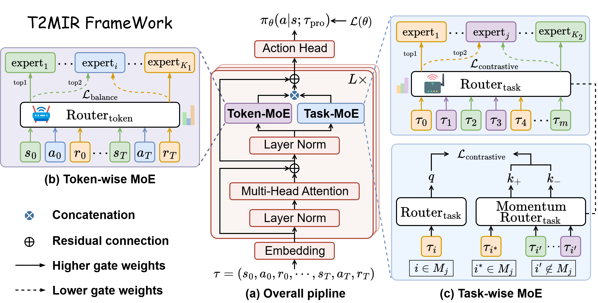

# Mixture-of-Experts Meets In-Context Reinforcement Learning
**Wenhao Wu$^1$, Fuhong Liu$^1$, Haoru Li$^1$, Zican Hu$^1$, Daoyi Dong$^2$, Chunlin Chen$^1$, Zhi Wang$^1$**  
$^1$Nanjing University &nbsp; $^2$University of Technology Sydney

## Overview
Official codebase for T2MIR: Mixture-of-Experts Meets In-Context Reinforcement Learning.
([arXiv](https://arxiv.org/abs/2506.05426) and [Hugging Face](https://huggingface.co/papers/2506.05426))



## Requirements
The version of Python is `3.11.10`.
To install dependencies, use:

```bash
# create a new environment
conda create -n t2mir python=3.11.10
conda activate t2mir

# install dependencies
pip install torch==2.4.1 torchvision==0.19.1 torchaudio==2.4.1 --index-url https://download.pytorch.org/whl/cu124
pip install flash-attn==2.6.3 --no-build-isolation
pip install -r requirements.txt

# install metaworld
git clone https://github.com/Farama-Foundation/Metaworld.git
cd Metaworld
git checkout cca35cff0ec62f1a18b11440de6b09e2d10a1380
pip install -e .
```

## Data Collection
We share our datasets vis [datasets](https://drive.google.com/drive/folders/1eDbgJ5J7L0fuTbNoOpbS-E48sUrJ1zLn?usp=sharing).

### Darkroom
We use optimal policy to generate dataset for DarkRoom by adding a decreasing noise as in [AD$^\epsilon$](https://arxiv.org/abs/2312.12275).

### Mujoco
We use SAC to train agents on different MuJoCo environments and collect datasets.  
Train agents on different tasks in Cheetah-Vel:

```bash
cd T2MIR-DPT
# training SAC agent
python train_agent.py cheetah-vel-v0 --task-id-start 0 --task-id-end 50
# generate dataset
python get_dataset.py cheetah-vel-v0 --task-id-start 0 --task-id-end 50 --capacity 1600
# generate query actions by expert policy
python label_actions.py cheetah-vel-v0
```

### Metaworld
We use PPO implemented by [Stable Baselines3](https://github.com/DLR-RM/stable-baselines3) to train agents on different Meta-World environments and collect datasets.  
Train agents on different tasks in Reach:

```bash
cd T2MIR-DPT
# training PPO agent
python mw_train_agent.py reach-v2 --task-id-start 0 --task-id-end 50
# generate dataset
python mw_get_dataset.py reach-v2 --task-id-start 0 --task-id-end 50 --capacity 100
# generate query actions
python mw_label_actions.py reach-v2
```

## Running Experiments
### Training
- To train `T2MIR-AD`, use:
```bash
cd T2MIR-AD
python train.py cheetah-vel-v0 --exp exp_0 --seed 3407
```

- To train `T2MIR-DPT`, use:
```bash
cd T2MIR-DPT
python train.py cheetah-vel-v0 --exp exp_0 --seed 3407
```

### Evaluation
We provide a `checkpoint` to reproduce the results in the paper.

- To evaluate `T2MIR-AD`, use:
```bash
cd T2MIR-AD
python eval.py cheetah-vel-v0 1 --exp exp_0 --seed 3407 --start-ckpt 89000 --stop-ckpt 89000 --seed-eval 10
```

- To evaluate `T2MIR-DPT`, use:
```bash
cd T2MIR-DPT
python eval_online.py cheetah-vel-v0 1 --exp exp_0 --seed 3407 --start-ckpt 59000 --stop-ckpt 59000 --seed-eval 10
```

The results will be saved in `exp_0-seed_3407/eval_1-seed_10/eval_return.csv`.


## Citation
If you find our paper useful, please consider to star this repository and cite it:

```tex
@inproceedings{wu2025t2mir,
    title={Mixture-of-Experts Meets In-Context Reinforcement Learning},
    author={Wenhao Wu and Fuhong Liu and Haoru Li and Zican Hu and Daoyi Dong and Chunlin Chen and Zhi Wang},
    booktitle={The Thirty-ninth Annual Conference on Neural Information Processing Systems},
    year={2025},
    url={https://openreview.net/forum?id=VMqxRPqdPw}
}
```